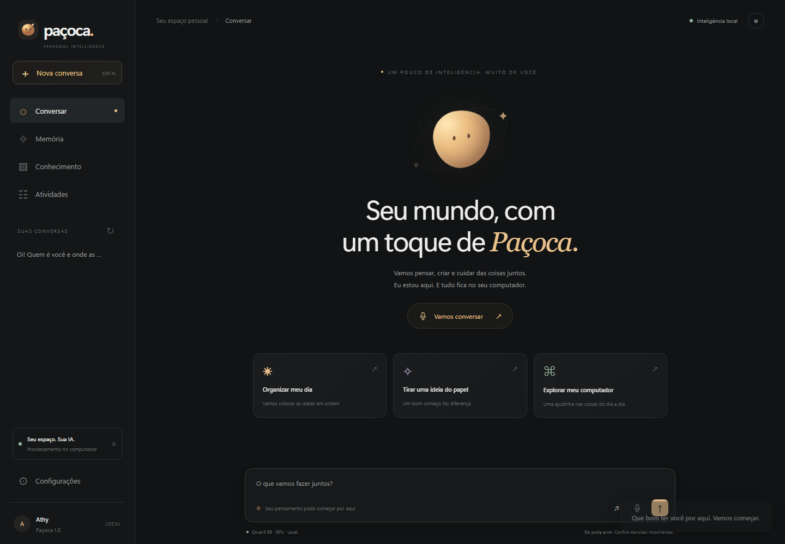

# Paçoca

**Sua inteligência pessoal. No seu computador.**

Uma nova aplicação desktop para Windows: conversa natural por texto e voz, memória pessoal, conhecimento dos seus documentos e ferramentas para ajudar no computador. A base foi recriada em `src/pacoca/`, usando o projeto anterior somente como referência.



## Instalar

[**Baixar a Paçoca para Windows**](https://github.com/AthirsonLamonato/Pacoca/releases/latest/download/Pacoca-Setup.exe) · [Versão 1.1.1](https://github.com/AthirsonLamonato/Pacoca/releases/tag/v1.1.1)

**Versão 1.1.1:** modo leve como padrão, modelos carregados sob demanda, atualizações automáticas autenticadas e comandos de aplicativos, jogos e Spotify.

Execute **`release/Pacoca-Setup.exe`**. O instalador inclui interface, motor de IA, transcrição, voz e navegador de automação. Ele baixa o modelo leve Qwen3 1.7B Q4_K_M de aproximadamente 1,1 GB, em revisão e SHA-256 fixados. Não exige Python, Ollama nem outro aplicativo de IA. O modelo 8B é opcional na instalação; cópias válidas já instaladas são preservadas.

Reserve aproximadamente 12 GB livres (20 GB com 8B). A primeira instalação precisa de internet. Depois, conversa, voz e memória são locais. Spotify, jogos online, navegação, Alexa e atualizações usam seus serviços de rede.

A Paçoca inicia sem carregar modelos. O modo diário usa CPU com dois threads e prioridade reduzida, libera os motores após inatividade e deixa a GPU disponível para os jogos. O modo avançado é uma escolha manual e é suspenso durante jogos conhecidos. Em Configurações, escolha o microfone e clique em **Vamos conversar**.

## Recursos

- Conversa com contexto, resposta progressiva e voz em português brasileiro.
- Sessão de microfone com detecção de fala, cancelamento de eco do navegador e interrupção da resposta.
- Qwen3 1.7B Q4_K_M (quantização Unsloth) no modo leve; Qwen3 8B opcional, com CUDA/Vulkan/CPU.
- Atualizações automáticas com assinatura do publicador, backup do banco e restauração dos arquivos anteriores se a nova janela falhar.
- Comandos diretos para abrir aplicativos, Valorant e CS2/Mata-mata, sem carregar o modelo de conversa.
- Spotify desktop: busca, reprodução e transferência para PC, Alexa ou celular pelo seletor Spotify Connect. Sem Web API ou credenciais de desenvolvedor.
- Memória pessoal editável e histórico persistente em SQLite.
- Busca textual em pastas autorizadas, com trechos e fontes de texto, código, PDF e DOCX.
- Catálogo único de ferramentas com argumentos validados, autorizações e resultados observados.
- Aplicativos, janelas, UI Automation, volume, arquivos, navegador dedicado e lembretes.
- Histórico de atividades, cancelamento, exportação, diagnóstico e inicialização no login.
- Adaptador de custom skill Alexa com assinatura, timestamp, vínculo de usuário e deduplicação.
- Instalador único com preparo automático do modelo e dados pessoais separados dos arquivos da aplicação.

## Executar o código novo

```powershell
python -m venv .venv
.\.venv\Scripts\python.exe -m pip install -r packaging/requirements.lock
.\.venv\Scripts\python.exe scripts/prepare_assets.py
$env:PYTHONPATH = 'src'
.\.venv\Scripts\python.exe -m pacoca
```

O preparo baixa recursos fixados e verifica integridade. Não há download de modelo nem fallback para IA na nuvem durante a inicialização do aplicativo instalado.

## Testar e empacotar

```powershell
$env:PYTEST_DISABLE_PLUGIN_AUTOLOAD = '1'
.\.venv\Scripts\python.exe -m pytest tests_next -p pytest_asyncio.plugin -q
.\.venv\Scripts\python.exe scripts/build_release.py
```

O build gera o executável com PyInstaller e o instalador com Inno Setup. Bibliotecas, transcrição e voz acompanham o pacote; o modelo de conversa é provisionado pelo próprio instalador a partir da URL e hash fixados. O resultado recebe SHA-256 em `release/SHA256SUMS.txt`. O instalador ainda não possui certificado Authenticode do Windows. Os pacotes de atualização possuem assinatura própria verificada pelo aplicativo.

## Documentação

- [Como usar, capacidades e limites](docs/USAR-PACOCA.md)
- [Conectar à Alexa](docs/ALEXA.md)
- [Arquitetura e plano da recriação](docs/recriacao-pacoca.md)
- [Validação da distribuição](docs/VALIDACAO-PACOCA.md)
- [Publicar atualizações autenticadas](docs/ATUALIZACOES.md)
- [Projeto anterior, preservado como referência](README.legacy.md)

Os arquivos legados na raiz, em `core/`, `modules/`, `input/`, `output/`, `storage/` e `web/` não são importados pelo aplicativo novo. `main.py`, `setup.bat` e os specs antigos pertencem à versão anterior. Use os comandos acima para a aplicação recriada.

## Privacidade e escopo

Dados pessoais ficam em `%LOCALAPPDATA%\Pacoca`. Pastas de conhecimento precisam ser adicionadas pelo usuário. Ações importantes mostram o conteúdo antes de pedir autorização. A automação opera na sessão atual do Windows e não contorna UAC nem a tela bloqueada.

A qualidade das respostas depende do modelo e do hardware. A ativação por palavra-chave e a restauração automática de exportações não estão habilitadas nesta versão. Alexa requer sua própria skill, conta e endpoint HTTPS; a integração real no Echo precisa ser configurada e testada com esses recursos.

O código da aplicação recriada é distribuído sob GPL-3.0-or-later. Licenças e avisos dos componentes acompanham a instalação; consulte `packaging/DISTRIBUTION.txt`.
