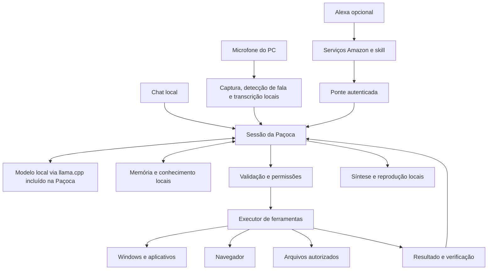

# Recriação da Paçoca: conversa natural, inteligência local e controle do Windows

Criado em 31/10/2026; atualizado em 02/11/2026. Estado: base desktop 1.0.1 implementada e novo planejamento abaixo para corrigir consumo de recursos, acrescentar atualização automática e operar aplicativos. Consulte [a validação da aplicação recriada](VALIDACAO-PACOCA.md) para distinguir entregas verificadas e homologações pendentes.

Decisão de distribuição da implementação: um único Setup.exe inclui o runtime, voz e transcrição e provisiona o Qwen3 8B por download HTTPS com revisão e SHA-256 fixados durante a instalação. O conjunto completo ultrapassou o limite de tamanho de um executável de instalação do Windows. Essa variante mantém o modelo 8B, dispensa qualquer outro programa e exige internet apenas no preparo inicial; o funcionamento da IA continua local. As propostas de pacote totalmente offline abaixo representam o plano original.

## Revisão de 02/11/2026: uso diário, atualizações e aplicativos

Registro do plano solicitado em 02/11. A implementação 1.1.1 fica em src/pacoca, com modo leve 1.7B sob demanda, processos de áudio descartáveis, atualizador autenticado e adaptadores de jogos/Spotify. Os detalhes abaixo preservam as decisões do plano; resultados medidos e limites estão em VALIDACAO-PACOCA.md.

Novos requisitos confirmados: atualização automática com a experiência do Telamentus; pedidos naturais para abrir aplicativos e jogos; abrir CS2 e entrar em mata-mata; operar o Spotify no PC e escolher PC, Alexa ou celular como destino da reprodução. O usuário confirmou Spotify Premium e que sua Alexa já aparece entre os dispositivos do Spotify. O pedido de enviar mensagens foi retirado do escopo pelo usuário.

### Recursos e execução das ações

- A interface, os lembretes e o atualizador devem funcionar sem carregar um modelo de linguagem.
- Comparar modelos menores, inicialmente na faixa de 1.7B a 4B, para o modo diário. O 8B já baixado permanece como opção para pedidos complexos, carregado quando escolhido. Definir o modelo após medir português, ferramentas e impacto no PC.
- Carregar modelos sob demanda e liberar suas alocações após inatividade. Enquanto estiver em jogo, o modo leve deve liberar a GPU e usar CPU com orçamento reduzido, ou pausar o processamento pesado. Limitar apenas VRAM não limita a disputa por processamento da GPU.
- Definir um orçamento conjunto para linguagem, transcrição e síntese, com poucos threads, prioridade baixa e contexto limitado. Medir carregamento, resposta e repouso; reduzir consumo em repouso também nas sessões ONNX de áudio.
- A compreensão continua aceitando linguagem natural e contexto. Depois de obter uma intenção estruturada, executar um adaptador específico do aplicativo, com argumentos validados, observação e resultado. Evitar pedir ao modelo para decidir novamente cada clique de um fluxo já conhecido.
- Um pedido explícito de abrir um aplicativo, iniciar a modalidade escolhida ou tocar música autoriza as etapas de baixo impacto desse fluxo. Não pedir confirmação para cada clique interno. Pedir esclarecimento se o alvo for ambíguo e nova autorização se uma etapa sair do objetivo solicitado.
- Usar eventos e consultas pontuais para acompanhar aplicativos. Captura contínua de tela e um modelo visual permanentemente carregado não fazem parte do funcionamento diário proposto.

### Atualização automática com a experiência do Telamentus

Foi lido o código atual em `../tela-p2p/electron/atualizacao.js`: consulta de versão, download automático, progresso, espera pela sessão livre, instalação/reinício e recuperação de falhas. A Paçoca usa PySide6; o comportamento será adaptado ao seu runtime, sem depender do atualizador Electron.

Fluxo proposto: consultar o canal oficial de releases por HTTPS → baixar o pacote em segundo plano com prioridade reduzida → verificar autenticidade e integridade → aguardar uma oportunidade de instalação → encerrar os processos da Paçoca → aplicar com um auxiliar → iniciar e verificar a versão nova.

- Mostrar versão instalada, versão disponível, progresso e as opções “Atualizar e reiniciar” e “Instalar ao fechar”. Uma atualização pronta não bloqueia novos pedidos do assistente.
- Instalar automaticamente somente com a sessão de voz encerrada, nenhuma tarefa ou autorização pendente e sem jogo em execução. Evitar também downloads grandes durante jogos. Se a oportunidade não chegar, manter a atualização pendente e permitir a decisão manual.
- Separar versões e pacotes de aplicação, runtime e modelos. Uma correção da interface ou lógica não deve baixar novamente todos os modelos ou o instalador de aproximadamente 1,8 GB. Bibliotecas e motores só entram quando suas versões mudarem.
- Manter modelos válidos, SQLite, memórias, preferências e Workspace. Atualizações de modelos devem informar o tamanho e depender de escolha do usuário; não promover silenciosamente o 8B a padrão.
- O manifesto deve conter versão, compatibilidade, tamanhos, hashes e assinatura verificável por chave pública fixada no aplicativo. A chave privada de publicação não acompanha o instalador. Não confiar somente em um hash fornecido pelo mesmo conteúdo remoto que será executado.
- Preparar a substituição fora do diretório ativo e manter uma versão anterior recuperável. Fazer backup do banco antes de migrações e definir compatibilidade para retorno; uma falha de renderização ou carregamento de DLL deve impedir a confirmação da atualização.
- Repetir o teste nativo introduzido na 1.0.1. Um servidor HTTP ativo sozinho não comprova que a janela Qt abre. Validar também atualização interrompida, pacote inválido, retorno à versão anterior e preservação dos dados.
- Sem internet, a IA local continua utilizável; o atualizador tenta novamente depois, sem iniciar inferência nem bloquear a interface.

Ainda será necessário preparar e publicar os pacotes e o manifesto no canal oficial do projeto. O código atual da Paçoca não tem esse atualizador implementado. Não houve publicação de release nesta revisão de planejamento.

### Abrir aplicativos e jogos

O catálogo genérico existente é uma base, mas abrir um processo não comprova que o aplicativo está pronto. Os adaptadores devem resolver nomes como “CS”, “Counter-Strike”, “Valorant” e “Spotify” para instalações observadas, guardar preferências e acompanhar estados como: abrindo launcher, aguardando carregamento, aplicativo pronto ou requer ação do usuário.

A confirmação deve relacionar a janela/processo esperado ao aplicativo solicitado. A aparição de uma janela qualquer não basta. Caso o jogo já esteja aberto, reutilizar a instância. Autenticação, instalação ausente ou uma atualização do launcher são estados próprios, sem repetir tentativas cegamente.

| Pedido | Fluxo a implementar | Resultado que precisa ser observado |
| --- | --- | --- |
| “Abre o Valorant” | Resolver a instalação, iniciar pelo launcher/atalho apropriado, acompanhar o carregamento e ativar o modo leve. | Jogo pronto ou indicação precisa de bloqueio no launcher. |
| “Abre o CS e entra no mata-mata” | Abrir pelo Steam/atalho observado, aguardar o menu, escolher a modalidade e iniciar o fluxo solicitado. | Modalidade selecionada, busca de partida iniciada e, se observável, entrada na partida. |
| “Abre o Spotify” | Abrir ou focar o aplicativo existente e observar sua sessão. | Janela correta disponível. Isso não implica que uma música começou. |

Para CS2, considerar o mata-mata online como hipótese inicial, a esclarecer se necessário no pedido. Iniciar um mapa local com bots não equivale a entrar em uma partida oficial. Uma busca de partida iniciada também não equivale a já estar jogando. O fluxo pela interface precisa de teste real; não há nesta revisão um comando homologado que complete esse processo inteiro.

Cada etapa terá timeout, cancelamento e observação de estado. Se a interface mudar, atualizar o adaptador e verificar novamente. Não repetir cliques antigos ou anunciar sucesso para um estado que não foi observado.

### Spotify no PC, Alexa e celular

O pedido deve distinguir **onde controlar** de **onde ouvir**. Em “abre o Spotify no PC, mas toca na Alexa”, o aplicativo continua no PC e o destino da reprodução é a Alexa já configurada.

Fluxo proposto: abrir Spotify → localizar a música/álbum/playlist → resolver ambiguidades de faixa ou artista → consultar os dispositivos visíveis → selecionar o destino → iniciar ou transferir a reprodução → conferir faixa, dispositivo e estado exibidos. Para comandos como pausar, continuar e próxima, avaliar também os controles de mídia do Windows quando expostos pelo aplicativo.

Exemplos de aceitação: “toca [música] aqui no PC”; “agora passa para a Alexa”; “continua no meu celular”; “pausa”. Ao transferir, preservar a posição quando o aplicativo permitir e verificar o resultado em vez de reiniciar a faixa por padrão.

O [Spotify Connect](https://support.spotify.com/br-pt/article/spotify-connect/) permite controlar a reprodução de outro dispositivo. Se o celular não aparecer, orientar a abrir o Spotify nele; a Paçoca não pode presumir que consegue acordar ou desbloquear o telefone. Se houver dispositivos com nomes repetidos, pedir a identificação antes de trocar a saída. Alterar a saída geral de áudio do Windows não substitui selecionar um dispositivo Spotify Connect.

Há um limite real para a escolha da integração: a [política da plataforma de desenvolvedores do Spotify](https://developer.spotify.com/policy), seção III.3, proíbe assistentes de voz construídos com essa plataforma. Premium não remove essa restrição. A proposta é avaliar controles de mídia do Windows e a interface existente do aplicativo para o uso pessoal solicitado, respeitando as condições aplicáveis; a Web API não fica presumida como autorizada para este assistente. Essa alternativa precisa ser testada e não será apresentada como uma integração oficial aprovada. O suporte do Spotify descreve [vinculação e uso com Alexa](https://support.spotify.com/br-pt/article/spotify-on-alexa-devices/).

A indicação do aplicativo de que a faixa está tocando no dispositivo correto será uma evidência de execução. A homologação de áudio no Echo e no celular exige um teste real nesses dispositivos. O adaptador atual da skill Alexa para pedidos ao PC é outro fluxo; não comprova esta transferência de reprodução.

### Sequência e critérios da próxima entrega

1. Medir e corrigir consumo: modo leve, carga sob demanda, inatividade e convivência com jogos/programas reais. Não publicar automaticamente uma revisão que continue causando os travamentos relatados.
2. Implementar atualização automática separada dos modelos, com progresso, espera por sessão livre, verificação e recuperação de falhas; testar ida e volta entre duas versões instaladas.
3. Homologar abertura e reconhecimento do estado de aplicativos, incluindo Valorant, CS2 e Spotify já instalados.
4. Homologar o fluxo de mata-mata no CS2 e o fluxo de música/dispositivo no Spotify, respeitando as possibilidades reais de cada interface.
5. Entregar instalador único e publicar o canal de atualização somente após validar os artefatos, a janela nativa e o funcionamento instalado. Registrar separadamente testes de código, aplicativo Windows, jogo online e áudio nos dispositivos.

Esta revisão alterou o planejamento. Não alterou a instalação, não executou partidas, não iniciou reprodução e não enviou mensagens. Atualização automática e os fluxos específicos acima continuam pendentes de implementação e homologação.

## Decisões confirmadas pelo usuário

- Recriar a Paçoca com uma base mais bem estruturada; o projeto atual é uma referência inicial.
- Uma única assistente com identidade própria, conversa natural e continuidade, tendo o modo voz do ChatGPT como referência de experiência.
- Modelos, reconhecimento de fala, síntese de voz e memória gratuitos e locais, aceitando diferenças de qualidade e velocidade.
- Controlar o computador e permitir integração com Alexa.
- Instalar somente a Paçoca: um instalador deve entregar o aplicativo e seus componentes, sem exigir instalação manual de Ollama, Python, LM Studio ou ferramentas de desenvolvimento.

“Do zero” se aplica ao aplicativo, à arquitetura e à experiência. A proposta usa modelos abertos já treinados. Treinar um modelo de linguagem fundacional do zero não cabe neste projeto pessoal. A identidade da Paçoca virá de comportamento, voz, memória e capacidades integradas.

O núcleo deve funcionar sem internet depois da instalação e do download dos modelos. Alexa e serviços externos precisam de internet; são conectores opcionais. Não haverá fallback silencioso para APIs de IA na nuvem.

## O que foi verificado na versão atual

Referência: `main`, commit `5283a2140eebbac396c7e6b285a6bd878b72a095`, de 20/08/2026. Cópia local criada a partir de `https://github.com/AthirsonLamonato/Pacoca`.

Esta é uma revisão dirigida de arquitetura e dos caminhos principais de conversa, voz e execução. Não é uma auditoria integral de todos os módulos.

| Evidência no código | Implicação para a recriação |
| --- | --- |
| `core/orchestrator.py:dispatch` testa regex antes do pipeline de intenção e da conversa. | A interação ainda é organizada principalmente como reconhecimento de comandos. O novo caminho principal deve ser uma sessão de conversa. |
| `core/orchestrator.py:_intent_dispatch` usa classificação local/cache e, no caminho Ollama, `parse_intent_ollama` seguido de execução. | O caminho local principal precisa de um ciclo completo de observação, escolha de ferramenta, resultado e nova decisão. |
| `modules/intent.py:_run_ollama_agentic_loop` já existe, mas usa o parser local e depois um resumo. O ciclo Groq devolve resultados ao modelo entre rodadas. | Não basta trocar o nome do provedor: o ciclo local precisa suportar decisões sucessivas com ferramentas nativas. |
| `modules/intent.py:_parse_with_ollama_nlu` solicita JSON em texto, sem enviar `tools`, com `num_predict: 128`. | A interface de ações depende de interpretação de texto; contratos estruturados devem vir de um único catálogo validado. |
| `input/stt.py:_capture_and_transcribe` captura a fala antes de transcrever. `output/tts.py` fala em threads e também tem streaming por frases. | Há peças reaproveitáveis, mas falta uma sessão de áudio coordenada, com cancelamento e tratamento de interrupções. |
| `core/config.yaml` usa `edge` como TTS e `hey_jarvis` quando não há wake word customizada; `keyword: paçoca` é cosmético. | A nova voz deve ser realmente local. A palavra de ativação Paçoca exige um trabalho próprio e não será anunciada como pronta por configuração. |
| `modules/system_control.py:_run_win` inicia um processo sem verificar seu resultado; `open_app` pode responder “Abrindo” sem confirmar a janela. | Solicitação enviada e ação concluída precisam ser estados diferentes. |
| `modules/task_agent.py` verifica parte dos resultados por texto e seu timeout/cancelamento é cooperativo entre etapas. | A nova execução precisa de resultados tipados, verificadores do estado real e limites por ferramenta. |
| Há memória, catálogo Pydantic, navegador Playwright, planos persistentes, políticas e testes. | Esses módulos fornecem requisitos, casos de teste e ideias úteis; não será necessário transportar toda a complexidade anterior. |

Validação executada nesta revisão:

```text
python -m pytest tests/test_config.py tests/test_context.py tests/test_task_agent.py tests/test_browser_agent.py -q --tb=short
36 passed in 1.27s
```

Foram usados os testes existentes, com plugins externos do pytest desativados. Não houve teste com microfone, modelo local em execução, navegador real, Alexa ou automação real do desktop. Nenhuma dependência ou modelo foi instalado nesta etapa.

Hardware identificado: Ryzen 7 5700X3D, aproximadamente 32 GB de RAM e NVIDIA RTX 4060 Ti com 8188 MiB de VRAM, conforme CIM e `nvidia-smi`. Esse levantamento permite escolher candidatos; não comprova desempenho de inferência. Ollama não foi encontrado no PATH consultado, o que não comprova ausência de outra instalação.

## Experiência desejada

A Paçoca deve conseguir conversar sem frases decoradas, entender correções e referências anteriores, explicar o que consegue fazer e usar ferramentas quando o pedido exigir uma ação.

Exemplo de comportamento a entregar:

> Usuário: “Paçoca, abre meus projetos e me ajuda a decidir por onde começar.”
>
> Paçoca: consulta os projetos autorizados e conversa sobre as opções.
>
> Usuário: “Aquele da obra. Abre a pasta dele.”
>
> Paçoca: resolve a referência pelo contexto, abre a pasta e verifica a janela.
>
> Usuário, interrompendo: “Espera, eu quis dizer a Paçoca.”
>
> Paçoca: interrompe a fala, incorpora a correção e ajusta a próxima ação.

O exemplo é um critério de produto, ainda não uma capacidade homologada. Diante de ambiguidade real, ela pergunta o mínimo necessário. Conversar sobre uma ação não deve dispará-la automaticamente.

## Arquitetura proposta



Uma identidade, um histórico de fatos pessoais e um catálogo de capacidades. Cada canal tem sua própria sessão e permissões. A troca de canal não mistura automaticamente aprovações, áudio ou dados privados. A resposta deve sair no canal que fez o pedido.

Começar com um núcleo Python e poucos componentes locais, evitando uma arquitetura de microserviços. Bibliotecas de áudio e automação rodam fora do loop principal quando puderem bloquear. Trabalhadores separados ficam restritos às operações que exigem isolamento ou encerramento por timeout.

| Parte | Escolha inicial para o protótipo | Decisão a validar |
| --- | --- | --- |
| Modelo de conversa e ferramentas | llama.cpp incluído na distribuição; comparar Qwen3 4B e 8B em GGUF quantizado. | Qualidade em português, acerto de ferramentas, tempo até a primeira resposta e VRAM total. |
| Detecção de fala | Silero VAD local. | Pausas, ruído, falas curtas e interrupção durante a reprodução. |
| Reconhecimento de fala | faster-whisper multilíngue; começar avaliando `small` em CPU/int8 e GPU. | Erros em nomes de projetos, datas, caminhos e português brasileiro. |
| Síntese de voz | Comparar Kokoro com voz pt-BR e Piper pt-BR. | Escuta pelo usuário, pronúncia, latência inicial e custo de CPU/GPU. |
| Interface | Aplicação web local servida por FastAPI, com texto, microfone e reprodução de áudio. | Captura contínua com cancelamento de eco no navegador e controles claros de privacidade. |
| Memória | SQLite, busca textual e embeddings locais opcionais. | Recuperação relevante sem trazer informações antigas ou contraditórias. |
| Windows | Adaptadores para APIs do sistema e UI Automation. | Verificação de janela, foco, resultado e permissões. |
| Navegador | Playwright com perfil dedicado. | Interação por elementos observados e verificação do resultado. |

A primeira versão usa áudio → transcrição → modelo → síntese, com processamento incremental. O objetivo é aproximar a fluidez desejada; isso não equivale a um modelo de voz nativo, nem garante a expressividade do ChatGPT.

Reservar a GPU principalmente para o modelo de conversa. Comparar STT/TTS em CPU e GPU com o aplicativo inteiro rodando: tamanho do arquivo do modelo não inclui contexto, buffers ou os demais modelos. Evitar carregar um modelo visual grande simultaneamente por padrão. Registrar versões, quantização e hashes dos modelos escolhidos para tornar os testes repetíveis.

O protótipo deve ouvir amostras das vozes antes de definir a identidade sonora. Kokoro e Piper são candidatos, não uma promessa de qualidade equivalente à voz de um serviço comercial. Verificar as licenças específicas do motor e dos modelos de voz antes de distribuir o aplicativo.

## Instalação única no Windows

A distribuição deve oferecer `Pacoca-Setup.exe`. O usuário instala, abre a Paçoca e escolhe o microfone. O pacote inclui o aplicativo, o runtime Python caso usado, o motor llama.cpp compilado, as bibliotecas necessárias e os modelos de conversa, transcrição e voz.

Preferir um instalador completo com os modelos para permitir uso offline após a instalação. Ele ocupará vários gigabytes; o tamanho exato será informado depois da escolha dos modelos. Uma edição menor pode baixar os modelos automaticamente dentro da Paçoca, com progresso, verificação de integridade e retomada, sem instruir o usuário a instalar outro programa.

O motor pode rodar em um processo auxiliar gerenciado pela Paçoca: iniciar ao abrir, encerrar ao sair e recuperar falhas. Esse processo pertence ao aplicativo instalado, sem serviço global nem painel de configuração externo. Se usar uma API interna, limitar a escuta ao loopback, autenticar as chamadas e escolher a porta automaticamente.

Compilar os componentes na preparação da distribuição; não exigir compilador, CUDA Toolkit, pip ou terminal no PC do usuário. Empacotar as bibliotecas redistribuíveis necessárias. A aceleração NVIDIA depende de um driver compatível já presente no Windows; oferecer execução em CPU quando a GPU não estiver disponível, com desempenho diferente.

O instalador organiza os binários e modelos na pasta do aplicativo, e mantém memória e preferências no diretório de dados do usuário. Atualizações comuns preservam esses dados e não baixam novamente modelos inalterados. A desinstalação permite escolher se os dados pessoais serão mantidos.

Critério obrigatório: instalar e executar em um Windows de teste sem Python, Ollama, LM Studio ou ambiente de desenvolvimento; testar também a edição completa sem rede e o caminho de execução por CPU. A distribuição ainda não foi construída nem homologada.

## Como entregar inteligência útil

1. **Contexto de conversa:** mensagens recentes, resumo de conversas longas e referências explícitas a aplicativos, arquivos e projetos. Evitar enviar toda a memória a cada turno.
2. **Memória pessoal verificável:** registrar preferências e fatos com origem, data e possibilidade de edição/exclusão. Separar o que o usuário afirmou do que o modelo inferiu. Aprendizado não significa retreinar os pesos a cada conversa.
3. **Conhecimento dos arquivos:** indexar apenas pastas escolhidas, atualizar itens alterados e indicar o arquivo de origem das respostas. Dados de documentos não se tornam instruções de execução.
4. **Planejamento com observação:** selecionar uma ação, executar, verificar e decidir o próximo passo pelo resultado real. Replanejar quando uma janela, página ou arquivo estiver diferente do esperado.
5. **Continuidade de tarefas:** persistir objetivo, etapas, evidências e estado. Após falha ou reinício, consultar o resultado antes de repetir ações; não retomar automaticamente ações externas ou destrutivas.
6. **Incerteza explícita:** perguntar quando existirem dois alvos plausíveis; informar quando faltar acesso, conhecimento atualizado ou ferramenta. A ausência de internet não pode ser escondida por uma resposta inventada.
7. **Melhoria medida:** manter um conjunto de conversas e tarefas reais em português, medir falhas e ajustar modelo, instruções e ferramentas a partir delas.

## Voz natural: requisitos de execução

- Ativar uma sessão de conversa por botão/atalho; durante a sessão, não exigir wake word a cada frase. Adicionar a ativação “Paçoca” depois de validar o restante.
- Capturar áudio continuamente enquanto a sessão estiver ativa. Exibir microfone ligado, saída escolhida e botão de silenciar.
- Processar transcrição parcial para a interface, mas executar ações somente depois de consolidar o pedido.
- Produzir texto e áudio por trechos curtos, mantendo a ordem e evitando ler raciocínio interno, JSON ou mensagens técnicas.
- Ao usuário começar a falar, parar a reprodução e invalidar os trechos antigos. Cancelar a geração anterior quando possível e não executar suas ferramentas pendentes.
- Usar identificadores de sessão, turno, tarefa e reprodução; resultados atrasados não podem ressuscitar uma fala ou ação cancelada.
- Distinguir “pare de falar” de “cancele a tarefa”. O botão de emergência cancela ambos e funciona sem esperar o modelo.
- Tratar o eco da própria voz. Avaliar primeiro com fone e depois com alto-falantes; VAD sozinho não cancela eco.
- Registrar o trecho efetivamente reproduzido para que o contexto não suponha que o usuário ouviu uma resposta inteira interrompida.

Metas iniciais de teste, ainda não medidas: primeira fala em até 3 s na mediana e 5 s no percentil 95 para pedidos simples com modelos aquecidos; interrupção da reprodução em até 500 ms. Medir também inicialização fria, memória e erros. Se a qualidade exigir maior tempo, apresentar o resultado e ajustar o perfil conscientemente.

## Controle do computador

Ordem de implementação: APIs específicas → UI Automation/DOM → imagem e coordenadas como recurso complementar. O modelo deve observar a interface antes de escolher elementos. “Controlar todo o computador” será uma expansão de capacidades testadas por aplicativo e tarefa; não existe garantia universal para qualquer programa.

Primeiro conjunto: listar/abrir aplicativos, consultar e alternar janelas, abrir pastas, ler/listar arquivos autorizados, controlar volume, navegar em sites escolhidos e criar um arquivo em pasta de trabalho. Fechar janelas com trabalho em andamento exige tratamento de salvamento.

Toda ferramenta deve declarar nome, argumentos, permissão, timeout, comportamento em repetição e forma de verificação. Retorno mínimo: estado, dados observados, erro e evidência. O catálogo gera o schema enviado ao modelo, evitando duplicar definições manualmente.

Exemplos de verificação: localizar a janela criada, conferir volume final, conferir caminho e conteúdo do arquivo, consultar o elemento/estado da página. Quando a conclusão não puder ser comprovada, retornar “não verificado”.

Permissões devem ser verificadas no executor, para todos os canais. Ações rotineiras e reversíveis podem ser autorizadas por escopo; exclusão, publicação, envio de mensagem, compra, instalação e alterações administrativas exigem uma decisão vinculada à ação e aos argumentos. Conteúdo de tela, página ou documento não concede permissões.

Não usar texto livre do modelo como comando PowerShell irrestrito. Resolver aplicativos por catálogo e identificadores; validar caminhos e argumentos. Usar o desktop da sessão do usuário, sem rodar toda a Paçoca como administrador. UAC, tela bloqueada e aplicativos elevados impõem limites reais do Windows.

## Integração com Alexa

A integração será uma custom skill em português brasileiro, com nome de invocação a testar, por exemplo “paçoca assistente”. A Alexa é uma entrada adicional para o mesmo núcleo; a transcrição e a voz do Echo passam pela Amazon. A skill não dá acesso irrestrito ao microfone do Echo e não transforma o aparelho no modo de conversa local da Paçoca.

Fluxo previsto: Echo → Alexa/skill → endpoint HTTPS dedicado → fila de pedidos autenticados → núcleo local → resultado da tarefa. A topologia da ponte deve ser escolhida depois de testar acesso externo; não depender de AWS paga nem prometer hospedagem gratuita permanente. O modo PC continua independente dessa ponte.

Requisitos: verificar assinatura e timestamp das requisições, Skill ID, usuário/dispositivo vinculado, duplicação por request ID e permissões do canal. Usar o SDK oficial para as verificações suportadas. Expor somente o endpoint necessário, mantendo o dashboard e o executor locais. Se houver um relay, o PC estabelece uma conexão autenticada de saída.

A skill trabalha com intents/slots e não deve assumir que recebe toda fala livre. Avaliar `AMAZON.SearchQuery` para pedidos abertos e respeitar suas regras. Há um prazo aproximado de oito segundos para a resposta completa; progressive response não o amplia. Para tarefas longas, responder que o pedido foi recebido, executar em segundo plano e permitir consulta posterior do estado. Não anunciar conclusão ao apenas enfileirar.

Testar o nome de invocação, reconhecimento em pt-BR, vínculo à conta do Echo e disponibilidade de um endpoint sem cobrança. Não assumir que uma skill customizada substitui a palavra de ativação Alexa ou oferece a mesma fluidez do microfone local.

## Etapas e critérios de entrega

| Etapa | Entrega utilizável | Critério para avançar |
| --- | --- | --- |
| 0 — Diagnóstico e projeto | Este plano, levantamento do hardware e testes dirigidos da versão atual. | Concluída nesta etapa; desempenho de IA ainda não avaliado. |
| 1 — Conversa local por voz | Chat, captura, transcrição, modelo e voz locais; continuidade e interrupção; primeira distribuição com todos os componentes. | Conversar por 10 min em português, corrigir três pedidos durante a fala, não ouvir eco e repetir o teste sem rede. Instalar em Windows de teste sem dependências prévias, conforme o requisito de instalação única. Registrar latência e uso de memória. |
| 2 — Memória pessoal | Preferências explícitas, histórico, resumo e consulta a pastas escolhidas. | Lembrar uma preferência após reiniciar, corrigir/esquecer um fato e citar corretamente arquivos de um conjunto de avaliação. |
| 3 — Windows | Catálogo inicial de ferramentas com resultado tipado e confirmação por escopo. | Resolver pelo menos 18 de 20 tarefas definidas previamente, sem falso sucesso nem ação fora do escopo. Parar corretamente quando falta acesso. |
| 4 — Tarefas com várias etapas | Navegador, observação de estado, recuperação de falhas e retomada supervisionada. | Completar 8 de 10 fluxos de três ou mais etapas, tratar falha planejada e não duplicar uma ação após interrupção/reinício. |
| 5 — Alexa | Skill, ponte e consulta de tarefas no mesmo núcleo. | Pedir ação pelo Echo, verificar no PC, rejeitar requisição inválida/repetida e explicar corretamente PC offline ou tarefa pendente. |
| 6 — Uso diário | Inicialização no login, diagnóstico, atualização e empacotamento. | Instalação limpa e sessão prolongada sem travamentos, crescimento contínuo de memória ou perda de configurações. |

Os limiares são critérios propostos para conjuntos de teste explícitos, não percentuais de capacidade geral. A conclusão exige testes reais das respectivas interfaces e equipamentos; mocks não homologam microfone, desktop ou Alexa.

## Estratégia de recriação

- Preservar o código atual como referência. Esta etapa altera somente documentação, na branch `planning/pacoca-local-v2`.
- Implementar a nova base em `src/pacoca/`, com configuração e dados próprios. A estrutura final pode conter `conversation`, `audio`, `memory`, `tools`, `channels` e `ui`; criar módulos conforme as entregas precisarem.
- No desenvolvimento, usar dependências fixadas em ambiente virtual. Para o usuário final, entregar todos os componentes pelo instalador da Paçoca. Baixar somente os modelos escolhidos para o primeiro teste e registrar seus tamanhos antes da instalação.
- Manter o núcleo portável onde isso não aumentar o escopo; testar os adaptadores Windows na máquina alvo e o restante da lógica em Windows/Linux.
- Migrar integrações antigas uma por vez, depois que a conversa estiver estável. Antes de importar memórias, validar esquema, origem e dados sensíveis; manter backup e não sobrescrever a base anterior.
- Não transportar inicialmente detecção de reuniões, produtividade, finanças e outras funções que não ajudam a validar a experiência central.

Próxima entrega concreta: protótipo da etapa 1 com llama.cpp gerenciado pela Paçoca, comparação Qwen3 4B/8B e Kokoro/Piper, primeira distribuição independente e relatório de latência. Gravar conversas somente com consentimento do usuário. A escolha definitiva de modelos deve sair desse teste.

## Fontes técnicas consultadas

- [Código da Paçoca no commit analisado](https://github.com/AthirsonLamonato/Pacoca/tree/5283a2140eebbac396c7e6b285a6bd878b72a095).
- [Ollama: tool calling, streaming e ciclo com resultados de ferramentas](https://docs.ollama.com/capabilities/tool-calling).
- [llama.cpp: biblioteca e compilação dos backends](https://github.com/ggml-org/llama.cpp/blob/master/docs/build.md): motor proposto após o requisito de instalação única; Ollama fica como referência da avaliação inicial.
- [PyInstaller: distribuição com interpretador e dependências](https://pyinstaller.org/en/stable/operating-mode.html).
- [Qwen3 8B GGUF](https://huggingface.co/Qwen/Qwen3-8B-GGUF) e [Qwen3 4B GGUF](https://huggingface.co/Qwen/Qwen3-4B-GGUF): candidatos locais; adequação conjunta ao hardware depende de medição.
- [faster-whisper: CPU, GPU e integração VAD](https://github.com/SYSTRAN/faster-whisper).
- [Silero VAD](https://github.com/snakers4/silero-vad).
- [Kokoro: modelo](https://huggingface.co/hexgrad/Kokoro-82M) e [vozes, incluindo português brasileiro](https://huggingface.co/hexgrad/Kokoro-82M/blob/main/VOICES.md).
- [Piper: motor local](https://github.com/OHF-Voice/piper1-gpl) e [modelos pt-BR](https://huggingface.co/rhasspy/piper-voices/tree/main/pt/pt_BR).
- [Microsoft: UI Automation e seus limites de segurança](https://learn.microsoft.com/en-us/dotnet/framework/ui-automation/ui-automation-security-overview).
- [Amazon: hospedagem HTTPS e verificação de requisições](https://developer.amazon.com/en-US/docs/alexa/custom-skills/host-a-custom-skill-as-a-web-service.html).
- [Amazon: verificar Skill ID](https://developer.amazon.com/en-US/docs/alexa/custom-skills/handle-requests-sent-by-alexa.html).
- [Amazon: nome de invocação](https://developer.amazon.com/pt-BR/docs/alexa/custom-skills/choose-the-invocation-name-for-a-custom-skill.html) e [tipos de slots](https://developer.amazon.com/en-US/docs/alexa/custom-skills/slot-type-reference.html).
- [Amazon: prazo de resposta e limites de progressive response](https://developer.amazon.com/en-US/docs/alexa/custom-skills/send-the-user-a-progressive-response.html).

As referências OpenAI Docs foram consultadas para comparar arquiteturas de voz e ferramentas. A proposta final respeita a escolha posterior do usuário por processamento local e não depende de serviços OpenAI.
